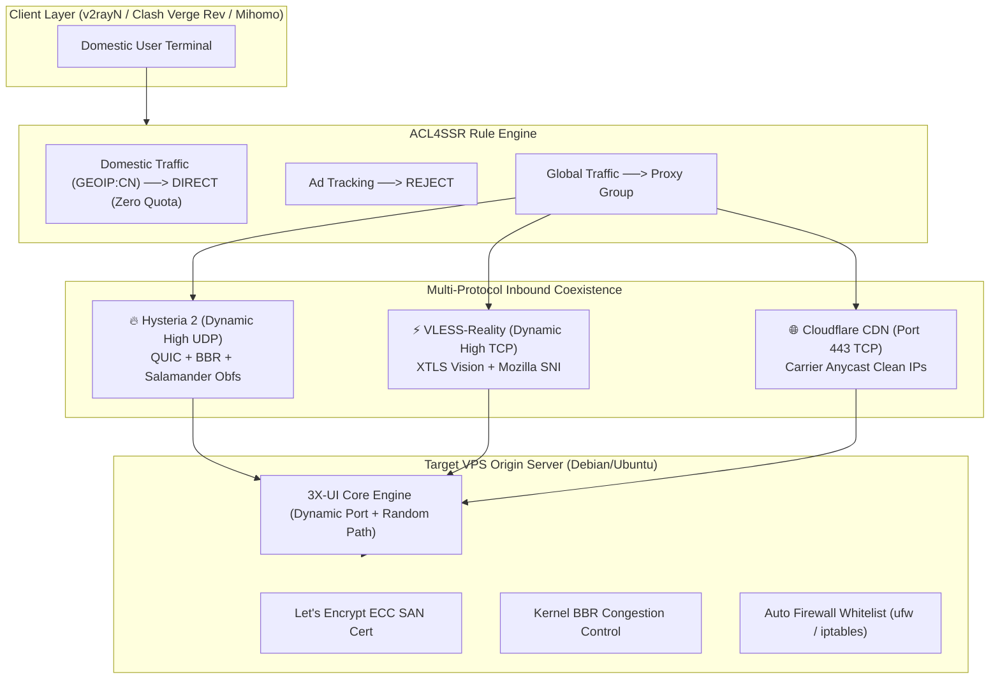

# 🚀 VPS Deployer Skill

> **Universal Multi-Protocol VPS Deployment & Cluster Automation Skill**  
> *Compatible with OpenAI GPTs, Anthropic Claude, Google Gemini / Antigravity, and Standalone CLI.*

[](LICENSE)
[](https://www.python.org/)
[](#multi-model-compatibility)
[](#internationalization-i18n)

[English](./README.md) | [中文说明](./i18n/README_zh.md)

---

## 📌 Overview

The **VPS Deployer Skill** equips developers, DevOps engineers, and autonomous AI agents with an intelligent deployment engine to transform any raw Linux VPS into a battle-tested multi-protocol proxy node with zero manual web GUI operations.

### Cross-Border Engineering Highlights:
* **Dynamic Non-Fixed High Ports**: Prevents GFW and ISP active probing. Hysteria 2, VLESS-Reality, and 3X-UI control panels are dynamically allocated random high ports with automated remote firewall (`ufw`/`iptables`) rule whitelisting.
* **Peak-Hour Congestion Resilience**: **Hysteria 2** with QUIC BBR and dynamic Salamander obfuscation; immune to TCP head-of-line blocking (handles 30%+ peak-hour packet loss).
* **Port 443 ISP Drop Bypass**: Direct connections use **VLESS-Reality** on dynamic high TCP ports with xtls-rprx-vision disguised behind Mozilla/target SNIs (1-RTT handshake).
* **IP Censorship Immunity**: **VLESS-WS-TLS (Port 443)** proxied through Cloudflare CDN with **Carrier Anycast Clean IPs** (optimized for China Unicom, China Mobile, and China Telecom).
* **Dual-Domain SAN Let's Encrypt ECC Certs**: Automatic Multi-Domain ECC certificates covering both IPv4 and IPv6 domains, preventing Cloudflare 526 SSL handshake errors.
* **Redundant Dual Clash Subscriptions**: Generates both primary (OnePage) and fallback (v1.mk) subscription URLs with embedded **ACL4SSR** domestic bypass rules, plus local offline YAML backup.

---

## 🏗️ Architecture



---

## ⚡ Quick Start

### 1. Standalone CLI Usage

Clone the repository and install lightweight dependencies:

```bash
git clone https://github.com/arifulcrypto/vps-deploy-skill.git
cd vps-deploy-skill
pip install -r requirements.txt
```

Deploy a server with a single command (ports will be dynamically randomized automatically):

```bash
python3 scripts/vps_deployer.py \
  --ip 198.51.100.1 \
  --ssh-port 22 \
  --ssh-user root \
  --ssh-pass "your_secure_password" \
  --domain "node.yourdomain.com" \
  --ipv6-domain "ipv6.yourdomain.com" \
  --client-isp "unicom" \
  --client-location "East Asia Regional Metro" \
  --output-dir "./output/node1" \
  --lang en
```

Or deploy from a JSON configuration file:

```bash
python3 scripts/vps_deployer.py --config examples/input_full.json
```

---

## 🤖 Multi-Model Compatibility

This skill is designed to work seamlessly with any LLM ecosystem:

| Model / Agent Platform | Configuration File / Directory | Integration Method |
| :--- | :--- | :--- |
| **Google Antigravity / Gemini CLI** | [`SKILL.md`](./SKILL.md) / [`.agents/skills/vps-deployer/`](./.agents/skills/vps-deployer/) | Auto-discovered by Antigravity CLI as an active Skill |
| **Anthropic Claude (Desktop / Code)** | [`claude/system_prompt.en.md`](./claude/system_prompt.en.md) | Mount as System Prompt or Project Knowledge |
| **OpenAI (Custom GPTs / Assistants)** | [`openai/gpt_instructions.en.md`](./openai/gpt_instructions.en.md) | Paste into Custom Instructions; import [`openai/actions_schema.json`](./openai/actions_schema.json) for Actions |

---

## 📂 Deliverables & Output Directory Structure

For every deployed machine, a dedicated output folder is generated:

```text
output/198.51.100.1/
├── vps_198.51.100.1_info.txt   # Structured specs + embedded terminal ASCII QR codes
├── clash_config.yaml           # Offline Clash configuration with ACL4SSR rules
├── node_hy2_qr.png             # High-resolution Hysteria 2 QR code
├── node_reality_qr.png         # High-resolution VLESS-Reality QR code
└── node_cf_443_qr.png          # High-resolution Cloudflare 443 QR code
```

### Redundant Dual Clash Subscriptions
The skill automatically generates two subscription channels:
1. **Primary OnePage Subscription**:
   `https://onepage.czl.net/api/sub-convert?target=clash&url=<ENCODED_NODES>&config=<ACL4SSR_CONFIG>`
2. **Fallback Gateway Subscription**:
   `https://api.v1.mk/sub?target=clash&new_name=true&url=<ENCODED_NODES>&config=<ACL4SSR_CONFIG>`
3. **Offline YAML Backup**: Saved locally as `clash_config.yaml` for direct import.

---

## 🌐 Internationalization (i18n)

* **Default Language**: English (`en`)
* **Primary Documentation**: English ([`SKILL.md`](./SKILL.md), [`README.md`](./README.md))
* **Chinese Documentation**: 中文说明 ([`i18n/SKILL_zh.md`](./i18n/SKILL_zh.md), [`i18n/README_zh.md`](./i18n/README_zh.md))

---

## 📄 License

Distributed under the MIT License. See [LICENSE](LICENSE) for details.
