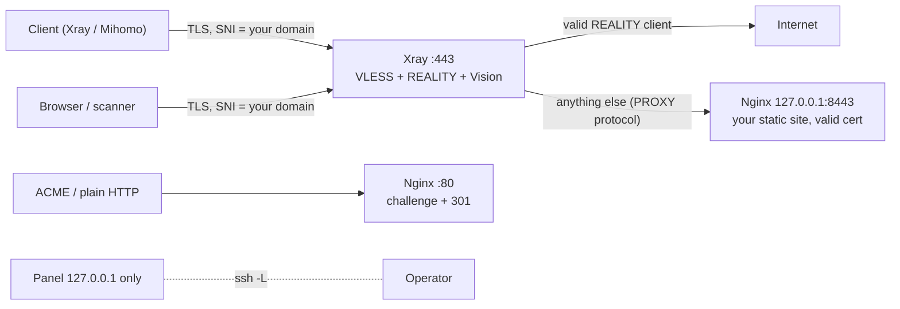

# VPS Deployer Skill

> Deploy and maintain a 3X-UI proxy node on a Linux VPS from an AI agent or the command line.
> *Works with OpenAI GPTs, Anthropic Claude, Google Gemini / Antigravity, and a standalone CLI.*

[](LICENSE)
[](https://www.python.org/)

[English](./README.md) | [中文说明](./i18n/README_zh.md)

---

## Overview

- **Two profiles.** `reality-self` puts everything on TCP 443: valid VLESS-REALITY-Vision clients are
  proxied, every other connection reaches the operator's own HTTPS website through a loopback Nginx, and
  an optional `--cdn-domain` adds a Cloudflare WebSocket path on the same port.
  `unified` (default, `legacy` is an alias) uses REALITY plus Hysteria 2, with VLESS-WS-TLS on 443 behind
  Cloudflare when a domain is set. REALITY takes a free 443 when no domain needs it, otherwise a random high port.
- **Checked before success.** No report, links or QR codes unless every remote step and listener check passes. The panel login probe is a warning unless you pass `--fail-closed`. A failed activation restores the previous panel database, and `state.json` only holds the last verified deployment.
  probe and website check succeeds. ACME failures are errors, never a silent self-signed certificate.
- **Non-destructive.** Existing web servers, foreign 3X-UI inbounds and clients, 2FA and panel TLS are
  left alone; destructive actions require explicit flags. The panel database is backed up and updated
  in a single transaction.
- **Stable re-runs.** Identity, secrets and ports live in `/etc/vps-skill/state.json` on the server and
  are reused; firewall rules are managed idempotently (ufw, firewalld or a dedicated iptables chain).
- **Private by default.** The panel listens on `127.0.0.1` (SSH tunnel). Artifacts are written 0600 in
  a 0700 directory. Clash YAML is generated locally; third-party converters are opt-in.

See [`SKILL.md`](./SKILL.md) for the full input table, runbook and troubleshooting guide.

## Architecture (`reality-self`)



## Quick start

```bash
git clone https://github.com/arifulcrypto/vps-deploy-skill.git
cd vps-deploy-skill
pip install -r requirements.txt          # requires openssh-client and sshpass for password auth

# 1. plan only (no remote changes)
python3 scripts/vps_deployer.py --config examples/input_reality_self.json --dry-run

# 2. deploy (password via environment instead of argv)
VPS_SSH_PASS='...' python3 scripts/vps_deployer.py --config examples/input_reality_self.json
```

`reality-self` needs a **DNS-only (grey cloud)** A record pointing at the VPS. Common flags:

| Flag | Purpose |
| :--- | :--- |
| `--profile {unified,legacy,reality-self,vision-tls}` | Deployment profile (default `unified`; `legacy` is an alias) |
| `--domain`, `--ipv6-domain`, `--panel-domain` | Hostnames (see SKILL.md for DNS mode per profile) |
| `--hy2 / --no-hy2` | Toggle Hysteria 2 |
| `--ssh-key`, `--ssh-known-hosts` | Key authentication; pinned host key instead of trust-on-first-use |
| `--xui-version v3.11.0` | Pin the 3X-UI release |
| `--adopt-existing-panel` | Manage a 3X-UI that this skill did not install |
| `--stop-conflicting-services` | Stop and disable a web server occupying 80/443 |
| `--rotate-secrets` | Issue new UUID/passwords/REALITY keys (old links stop working) |
| `--online-sub / --no-online-sub` | Third-party converter URLs, on by default (they receive your node credentials) |
| `--sub / --no-sub`, `--sub-port` | 3X-UI built-in subscription, on by default when the panel is public |
| `--cdn-domain` | `reality-self`: Cloudflare hostname sharing the HTTPS port with REALITY and the website |
| `--extra-protocols vmess,trojan` | Opt-in compatibility inbounds (`--vmess-port`, `--trojan-port`) |
| `--https-port`, `--web-backend-port` | Public HTTPS port and the `reality-self` loopback website port |
| `--cert-mode {http-01,dns-01}`, `CF_TOKEN` | DNS-01 through Cloudflare, for hosts without public port 80 |
| `--manage-dns` | Create or update Cloudflare records. Needs `Zone: DNS: Edit`; records it didn't create are never changed |
| `--cdn-transport {ws,xhttp,both}` | CDN transport. `both` is the `reality-self` default |
| `--exit-port`, `exit_proxy` in config | Send one inbound's traffic out through a residential SOCKS or HTTP proxy |
| `--hy2-masquerade`, `--no-hy2-obfs` | Serve the website to HTTP/3 visitors on the Hysteria 2 port |
| `--hy2-up`, `--hy2-down` | Client Mbps for Hysteria 2. Unset means BBR. Setting them selects Brutal |
| `--from-lxc result.json --container <name>` | Take ports and access from vps-lxc-skill |

## Agent integration

| Platform | File | How |
| :--- | :--- | :--- |
| Google Antigravity / Gemini CLI | [`SKILL.md`](./SKILL.md), [`.agents/skills/vps-deployer/`](./.agents/skills/vps-deployer/) | Auto-discovered skill |
| Anthropic Claude | [`claude/system_prompt.en.md`](./claude/system_prompt.en.md) | System prompt / project knowledge |
| OpenAI GPTs | [`openai/gpt_instructions.en.md`](./openai/gpt_instructions.en.md), [`openai/actions_schema.json`](./openai/actions_schema.json) | Instructions + Actions (requires your own HTTPS wrapper around the CLI) |

## Output

```text
output/<ip>/                 (0700, files 0600 — they contain credentials)
├── vps_<ip>_info.txt        report with links and terminal QR codes
├── result.json              machine-readable result
├── clash_config.yaml        local Clash/Mihomo config
└── qr_<node>.png            QR codes
```

## Development

```bash
pip install -r requirements-dev.txt
ruff check scripts tests && pytest -q
```

The tests execute the generated database script against a schema modelled on 3X-UI v3.11.0, run the
panel probe against a fake CSRF-enforcing panel, syntax-check every generated remote shell script, and
drive the whole pipeline through a scripted fake SSH target. They do not replace a test on a real VPS.

## License

MIT, see [LICENSE](LICENSE).

## Reboot Rules

Reboots need no manual work. Every deployment installs a boot self-check.

After every boot, `vps-skill-bootcheck.timer` reapplies the firewall, starts `x-ui` and Nginx if needed, confirms every planned port is listening, and restarts `x-ui` once if ports stay missing. The result is written to `/var/lib/vps-skill/boot-status`.

**Rules for agents**

- After a reboot, wait 3 minutes, then read the status file.
- `OK` means finished. Do not restart anything.
- `FAILED` lists what stayed down. Read `/var/log/vps-skill-bootcheck.log`, fix that item, then run `systemctl start vps-skill-bootcheck.service`.
- Never reboot again as a first response.
- With vps-lxc-skill, also read `/var/lib/vps-lxc/boot-status` on the host. Containers must be up before this check can pass.
- With vps-lxc-skill, `upstream-down=` in the status means a relay or proxy exit outside this host didn't answer. Local services are fine, so check that provider.
- A deployment made before this feature gets the check on its next deployer run. Reruns keep links and ports.

## Residential and Relay Exits

Choose by what you need the exit to do.

| Pattern | Set up with | Traffic path | Use when |
| :--- | :--- | :--- | :--- |
| Whole node through a proxy | `exit_proxy` + `exit_all: true` | Client -> VPS -> residential proxy -> site | One container should always look residential |
| One extra node through a proxy | `exit_proxy` + `exit_port` | As above, for that node only | You want normal and residential nodes on one server |
| Layer 4 relay | Realm, then `relays` | Client -> VPS -> your own exit server -> site | You own a server elsewhere |

- **Sticky sessions:** commercial pools often take session settings in the username. DataImpulse uses `USER__cr.us;sessid.NAME;sessttl.1440` for the same IP for up to 24 hours. Connections drop when the session ends, and clients reconnect with a new IP automatically. Check your provider's syntax.
- **TCP only:** many such proxies don't carry UDP, so `exit_all` blocks QUIC on port 443. Apps fall back to TCP through the proxy, and traffic can't leak out through the VPS address.
- **Metered traffic:** residential nodes are never in automatic latency testing. Keep it that way, because probes use paid traffic.
- **Check the real exit:** run a client, open `https://www.cloudflare.com/cdn-cgi/trace`, and look up the IP. A provider calling a line "residential" doesn't prove it.
- **Combine servers:** merge per-server files into one client config, with metered nodes kept out of automatic groups:

```bash
python3 scripts/merge_clash.py --output cluster.yaml c1.yaml:direct c2.yaml:residential c3.yaml:relay
```

## Xray Compatibility & Client Group Ordering

### 1. Xray Core Version Pinning for Mihomo / Clash Verge Rev
- **Upstream Change**: Starting with Xray-core `v26.7.11`, upstream altered REALITY handshake/AEAD verification logic. Clients using Mihomo (Clash Meta / Clash Verge Rev) fail REALITY authentication (`REALITY Authentication: false`) against newer Xray cores.
- **Universal Stable Release**: Deploy Xray-core `v26.6.27`. It fully supports the modern 3X-UI `tunnel` Inbound while maintaining 100% cryptographic compatibility with Mihomo and v2rayN.
- **Vision Flow Override**: In 3X-UI deployments, `client_inbounds.flow_override` must be populated with `xtls-rprx-vision`. If empty, Xray omits client flow on restart, causing v2rayN to fail with `-1`.

### 2. Dual-Exit & Fallback Architecture
When relaying traffic to an external landing node (e.g. US ISP NAT via Realm):
- Generate both the relayed link (`vless://...@RELAY_IP:RELAY_PORT...`) and the direct landing link (`vless://...@LANDING_IP:LANDING_PORT...`) as an unrelayed fallback.
- Both endpoints should be documented in `vless_node.txt`, Base64 subscriptions, and Clash YAML.

### 3. Clash Verge Rev UI Placement & Neutral Naming
- In `proxy-groups:`, place `🚀 节点选择` at index 0 so it appears as the primary card in the Clash Verge Rev UI.
- Set `⚡ 自动选择 (低延迟)` as the first option within `🚀 节点选择`.
- Ensure acyclic group graphs without circular back-references from child groups (`AI与ChatGPT`, `外贸与TikTok`) to `🚀 节点选择`.
- Enforce neutral naming conventions without sensitive ISP/carrier names in client profiles.
