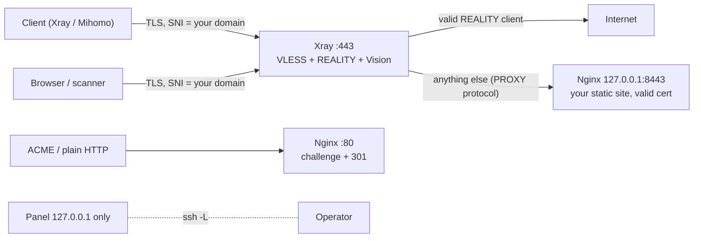

# VPS Deployer Skill

> Deploy and maintain a 3X-UI proxy node on a Linux VPS from an AI agent or the command line.
> *Works with OpenAI GPTs, Anthropic Claude, Google Gemini / Antigravity, and a standalone CLI.*

[](LICENSE)
[](https://www.python.org/)

[English](./README.md) | [中文说明](./i18n/README_zh.md)

---

## Overview

- **Two profiles.** `reality-self` puts everything on TCP 443: valid VLESS-REALITY-Vision clients are
  proxied, every other connection reaches the operator's own HTTPS website through a loopback Nginx.
  `legacy` keeps the multi-port layout (REALITY on a random high port, optional Hysteria 2, VLESS-WS-TLS
  on 443 behind Cloudflare).
- **Fail closed.** No report, links or QR codes unless every remote step, listener check, panel login
  probe and website check succeeds. ACME failures are errors, never a silent self-signed certificate.
- **Non-destructive.** Existing web servers, foreign 3X-UI inbounds and clients, 2FA and panel TLS are
  left alone; destructive actions require explicit flags. The panel database is backed up and updated
  in a single transaction.
- **Stable re-runs.** Identity, secrets and ports live in `/etc/vps-skill/state.json` on the server and
  are reused; firewall rules are managed idempotently (ufw, firewalld or a dedicated iptables chain).
- **Private by default.** The panel listens on `127.0.0.1` (SSH tunnel). Artifacts are written 0600 in
  a 0700 directory. Clash YAML is generated locally; third-party converters are opt-in.

See [`SKILL.md`](./SKILL.md) for the full input table, runbook and troubleshooting guide.

## Architecture (`reality-self`)



## Quick start

```bash
git clone https://github.com/arifulcrypto/vps-deploy-skill.git
cd vps-deploy-skill
pip install -r requirements.txt          # requires openssh-client and sshpass for password auth

# 1. plan only (no remote changes)
python3 scripts/vps_deployer.py --config examples/input_reality_self.json --dry-run

# 2. deploy (password via environment instead of argv)
VPS_SSH_PASS='...' python3 scripts/vps_deployer.py --config examples/input_reality_self.json
```

`reality-self` needs a **DNS-only (grey cloud)** A record pointing at the VPS. Common flags:

| Flag | Purpose |
| :--- | :--- |
| `--profile {legacy,reality-self}` | Deployment profile (default `legacy`) |
| `--domain`, `--ipv6-domain`, `--panel-domain` | Hostnames (see SKILL.md for DNS mode per profile) |
| `--hy2 / --no-hy2` | Toggle Hysteria 2 |
| `--ssh-key`, `--ssh-known-hosts` | Key authentication; pinned host key instead of trust-on-first-use |
| `--xui-version v3.11.0` | Pin the 3X-UI release |
| `--adopt-existing-panel` | Manage a 3X-UI that this skill did not install |
| `--stop-conflicting-services` | Stop and disable a web server occupying 80/443 |
| `--rotate-secrets` | Issue new UUID/passwords/REALITY keys (old links stop working) |
| `--online-sub` | Also print third-party converter URLs (they receive your credentials) |

## Agent integration

| Platform | File | How |
| :--- | :--- | :--- |
| Google Antigravity / Gemini CLI | [`SKILL.md`](./SKILL.md), [`.agents/skills/vps-deployer/`](./.agents/skills/vps-deployer/) | Auto-discovered skill |
| Anthropic Claude | [`claude/system_prompt.en.md`](./claude/system_prompt.en.md) | System prompt / project knowledge |
| OpenAI GPTs | [`openai/gpt_instructions.en.md`](./openai/gpt_instructions.en.md), [`openai/actions_schema.json`](./openai/actions_schema.json) | Instructions + Actions (requires your own HTTPS wrapper around the CLI) |

## Output

```text
output/<ip>/                 (0700, files 0600 — they contain credentials)
├── vps_<ip>_info.txt        report with links and terminal QR codes
├── result.json              machine-readable result
├── clash_config.yaml        local Clash/Mihomo config
└── qr_<node>.png            QR codes
```

## Development

```bash
pip install -r requirements-dev.txt
ruff check scripts tests && pytest -q
```

The tests execute the generated database script against a schema modelled on 3X-UI v3.11.0, run the
panel probe against a fake CSRF-enforcing panel, syntax-check every generated remote shell script, and
drive the whole pipeline through a scripted fake SSH target. They do not replace a test on a real VPS.

## License

MIT, see [LICENSE](LICENSE).
