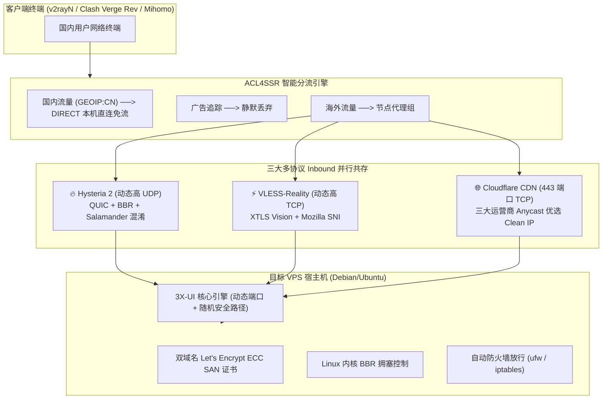

# 🚀 VPS Deployer Skill（中文文档）

> **通用多协议 VPS 自动化部署与多机集群管理 Skill**  
> *全面兼容 OpenAI GPTs、Anthropic Claude、Google Gemini / Antigravity 以及独立 CLI 命令行执行。*

[English](./../README.md) | [中文说明](./README_zh.md)

---

## 📌 项目概述

**VPS Deployer Skill** 旨在帮助开发者与 AI 助手将任意 Linux 海外裸机 VPS 一键转变为高可用、抗封锁、去特征化的多协议代理节点，全程无需手动在 Web 界面中点击配置。

### 跨境网络核心工程优化：
* **动态非固定高端口**：防范 GFW 与运营商的主动探测。Hysteria 2、VLESS-Reality 与 3X-UI 控制面板全面采用动态分配随机高端口，并在部署时自动放行系统防火墙（`ufw` / `iptables`）。
* **晚高峰骨干网抗丢包**：采用 **Hysteria 2** 协议，配合 QUIC BBR 与随机 Salamander 混淆，晚高峰 30% 丢包照样跑满千兆带宽。
* **运营商海外 443 端口主动丢包绕过**：直连节点采用 **VLESS-Reality** 动态高 TCP 端口，借壳 Mozilla 官方证书与流量特征，1-RTT 极速握手。
* **IP 阻断与审查免疫**：**VLESS-WS-TLS（443 端口）** 走 Cloudflare Anycast CDN，挂载三大运营商专属 **Clean Anycast 优选 IP**。
* **IPv4/IPv6 双栈免报错**：自动签发双域名 Let's Encrypt ECC SAN 证书，彻底解决 IPv6 回源触发 Cloudflare 526 SSL 报错。
* **双轨 Clash 订阅冗余交付**：自动输出 OnePage 主订阅与 v1.mk 备用订阅双链接（已内置 **ACL4SSR** 规则，国内流量 DIRECT 直连免流），并落盘离线 YAML 备份。

---

## 🏗️ 架构拓扑



---

## ⚡ 快速上手

### 1. 独立命令行调用

克隆本仓库并安装轻量依赖：

```bash
git clone https://github.com/arifulcrypto/vps-deploy-skill.git
cd vps-deploy-skill
pip install -r requirements.txt
```

一条命令驱动全量部署（端口将自动随机生成，防主动探测）：

```bash
python3 scripts/vps_deployer.py \
  --ip 198.51.100.1 \
  --ssh-port 22 \
  --ssh-user root \
  --ssh-pass "your_secure_password" \
  --domain "node.yourdomain.com" \
  --ipv6-domain "ipv6.yourdomain.com" \
  --client-isp "unicom" \
  --client-location "区域中心城市" \
  --output-dir "./output/node1" \
  --lang en
```

或使用 JSON 配置文件直接加载：

```bash
python3 scripts/vps_deployer.py --config examples/input_full.json
```

---

## 🤖 多模型 AI 平台适配指南

| AI 模型 / Agent 平台 | 适配文件 | 使用方式 |
| :--- | :--- | :--- |
| **Google Antigravity / Gemini CLI** | [`SKILL.md`](./../SKILL.md) / [`.agents/skills/vps-deployer/`](./../.agents/skills/vps-deployer/) | 直接放置于项目根目录，Antigravity 自动识别为可用 Skill |
| **Anthropic Claude (Desktop / Code)** | [`claude/system_prompt.zh.md`](./../claude/system_prompt.zh.md) | 作为 System Prompt 或项目知识库挂载 |
| **OpenAI (Custom GPTs / Assistants)** | [`openai/gpt_instructions.zh.md`](./../openai/gpt_instructions.zh.md) | 粘贴到 GPTs 指令中，导入 [`openai/actions_schema.json`](./../openai/actions_schema.json) 实现 Action 调用 |

---

## 📂 自动化落盘资产目录结构

每台部署完毕的主机将生成独立的归档文件夹：

```text
output/198.51.100.1/
├── vps_198.51.100.1_info.txt   # 结构化说明文档 + 内嵌终端 ASCII 二维码
├── clash_config.yaml           # 离线 Clash 配置文件（已内置 ACL4SSR 规则）
├── node_hy2_qr.png             # Hysteria 2 高清二维码
├── node_reality_qr.png         # VLESS-Reality 高清二维码
└── node_cf_443_qr.png          # Cloudflare 443 高清二维码
```

### 双轨 Clash Verge Rev 订阅直出
自动为客户端输出双轨订阅链接，提供主备冗余：
1. **主通道 (OnePage 在线转换)**:
   `https://onepage.czl.net/api/sub-convert?target=clash&url=<ENCODED_NODES>&config=<ACL4SSR_CONFIG>`
2. **备用通道 (v1.mk 备用网关)**:
   `https://api.v1.mk/sub?target=clash&new_name=true&url=<ENCODED_NODES>&config=<ACL4SSR_CONFIG>`
3. **离线本地 YAML**: 保存为 `clash_config.yaml` 供离线直接导入。

---

## 📄 开源许可证

本项目基于 MIT License 协议开源。详情见 [LICENSE](./../LICENSE)。
